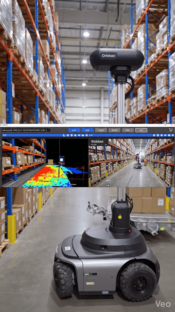
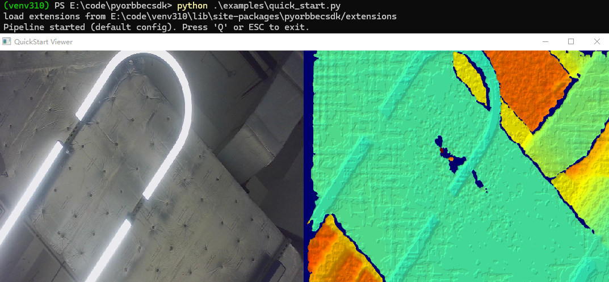

<h1 align="center">
  pyorbbecsdk
  <br>
</h1>

<p align="center">
  <a href="README.md">English</a> | <strong>中文</strong>
</p>

<p align="center">
  Orbbec SDK v2.x 的 Python 绑定
  <br />
  官方 Python 封装库，基于 pybind11 绑定原生 C++ SDK，让开发者通过简洁、符合 Python 使用习惯的 API 使用 Orbbec RGB-D 相机（Gemini、Femto、Astra 系列）。
</p>

<p align="center">
  <a href="https://orbbec.github.io/pyorbbecsdk/zh_CN/index.html">文档</a>
  ·
  <a href="docs/README_zh-CN.md">仓库文档</a>
  ·
  <a href="https://pypi.org/project/pyorbbecsdk2/">PyPI 软件包</a>
  ·
  <a href="https://github.com/orbbec/pyorbbecsdk/issues">社区</a>
  ·
  <a href="https://github.com/orbbec/OrbbecSDK_v2">OrbbecSDK v2</a>
  ·
  <a href="https://gitee.com/orbbecdeveloper/pyorbbecsdk">Gitee 镜像</a>
</p>

<p align="center">
  <a href="https://github.com/orbbec/pyorbbecsdk/actions/workflows/build.yaml"></a>
  <a href="https://pypi.org/project/pyorbbecsdk2/"></a>
  <a href="https://www.python.org/"></a>
  <a href="LICENSE"></a>
</p>

---

> **分支说明：** 当前为 `v2-main` 分支（SDK v2.x）。如需旧版 v1.x 分支，请查看 [main](https://github.com/orbbec/pyorbbecsdk/tree/main)。SDK v1.x 与 v2.x 的区别详见 [OrbbecSDK_v2 README](https://github.com/orbbec/OrbbecSDK_v2)。

> **安装方式变更：** 运行示例脚本所需的额外第三方依赖包不再默认安装，可按需通过 `examples` 可选依赖组安装。
> `pip install "pyorbbecsdk2"` 仅安装核心 SDK 和 NumPy。
> **如需运行示例，请使用 `pip install --upgrade "pyorbbecsdk2[examples]"`。**
> 如果已经安装 SDK，也可执行上述命令，补装运行示例所需的依赖包。
> `examples` 可选依赖组沿用此前默认安装时的依赖版本约束，其中 NumPy 的版本范围会根据 Python 版本确定。

## 目录

- [概览](#概览)
- [支持的设备](#支持的设备)
- [功能特点](#功能特点)
- [快速入门](#快速入门)
- [示例](#示例)
- [支持的平台](#支持的平台)
- [自动固件升级](#自动固件升级)
- [常见问题](#常见问题)
- [社区](#社区)
- [更新日志](#更新日志)
- [许可证](#许可证)

## 概览

<table style="width: 100%; table-layout: fixed;">
  <tr>
    <th style="width: 33.33%; text-align: center;">AMR 生鲜配送</th>
    <th style="width: 33.33%; text-align: center;">人体健康追踪</th>
    <th style="width: 33.33%; text-align: center;">3D 人脸支付</th>
  </tr>
  <tr>
    <td></td>
    <td></td>
    <td></td>
  </tr>
</table>

## 支持的设备

> **重要说明：**
> - 大多数新设备已预装兼容固件，开箱即可使用。
> - 自 2025 年 10 月起（Orbbec SDK v2.5.5），使用 OpenNI 协议的设备将升级为 UVC 协议。详情请参阅[升级文档](https://github.com/orbbec/OrbbecSDK_v2?tab=readme-ov-file#12-upgrading-from-openni-protocol-to-uvc-protocol)。
> - 如需使用旧版 v1.x 支持的设备（Astra+、Astra Pro Plus、Gemini 2 XL），请使用 [main 分支](https://github.com/orbbec/pyorbbecsdk/tree/main)。

各分支的区别及支持的设备列表，请参阅[简介：设备支持对比](https://orbbec.github.io/pyorbbecsdk/zh_CN/source/1_overview/Introduction.html#device-support-comparison)。

## 功能特点

- 📷 **RGB-D 数据流** — 获取深度、彩色和红外数据流，支持配置分辨率和帧率（FPS）。
- 🛠️ **后处理滤波器** — 支持时域、空域、填洞、截断、下采样和去噪滤波（Temporal、Spatial (Advanced)、HoleFilling、Threshold、Decimation、Noise Removal）。
- 🎯 **深度与彩色对齐** — 支持软件 `AlignFilter` 和硬件 D2C 对齐。
- ☁️ **点云生成** — 通过 `PointCloudFilter` 生成彩色 3D 点云。
- 📐 **相机标定数据** — 获取相机内参、畸变系数和外参，用于标定与坐标变换。
- ⚡ **实时性能** — 通过 pybind11 调用原生 C++ SDK，满足实时数据处理需求。
- 🌐 **网络相机** — 通过以太网连接 Femto Mega / Gemini 2 XL。
- 📦 **预编译 wheel 包** — 在 Windows x64、Linux x64/ARM64 和 macOS（Apple Silicon）上无需自行编译。

## 快速入门

pyorbbecsdk 集成了访问相机所需的 SDK 库，并提供示例脚本，帮助你采集数据、调整参数和了解相机功能。

按以下步骤开始使用：

**1. 安装 SDK 及运行示例所需的依赖包**

推荐首次使用时通过 PyPI 安装：

```bash
pip install --upgrade "pyorbbecsdk2[examples]"
```

如果你的应用只需要核心 SDK 和 NumPy：

```bash
pip install --upgrade "pyorbbecsdk2"
```

安装 `examples` 可选依赖组时，会同时应用适合当前 Python 版本的 NumPy 版本约束，以兼容相关示例使用的第三方库。

如果已将 wheel 包下载到当前目录，可在文件名后加上 `[examples]`，同时安装该软件包及运行示例所需的依赖包。请将下方文件名替换为实际下载的、与你的 Python 版本和系统架构匹配的 wheel 文件名：

```bash
pip install "pyorbbecsdk2-2.1.4-cp310-cp310-macosx_11_0_arm64.whl[examples]"
```

> **务必用双引号括住整个参数，包括 `[examples]`。** 在 macOS 上，zsh 会将未加引号的方括号视为文件名匹配模式，可能在 pip 或 uv 执行前报错：
> `zsh: no matches found`。用引号括住参数也能正确处理路径中的空格。软件包名称和本地 wheel 文件路径均适用。

> 💡 **推荐使用虚拟环境**
>
> 在部分系统环境中（如 macOS、Ubuntu 24.04+），直接通过 pip 向系统 Python 安装软件包可能受到限制。建议使用虚拟环境，避免权限或系统包管理冲突：
>
> ```bash
> # Create and activate virtual environment
> python3 -m venv orbbec_env
> source orbbec_env/bin/activate  # Linux/macOS
> # .\orbbec_env\Scripts\Activate.ps1  # Windows PowerShell
>
> # Install SDK and example dependencies in virtual environment
> pip install --upgrade "pyorbbecsdk2[examples]"
> ```
> 更多选项（venv、pyenv、conda）请参阅[虚拟环境指南](https://orbbec.github.io/pyorbbecsdk/zh_CN/source/2_installation/virtual_environment_guide.html)。

> 🔧 **需要从源码构建？**
> 详细步骤请参阅[使用 UV 构建指南](https://orbbec.github.io/pyorbbecsdk/zh_CN/source/4_Package/build_with_uv.html)。

> **说明：** PyPI 为 Windows x64、Linux x64/ARM64 和 macOS（Apple Silicon）上的所有受支持 Python 版本（3.8–3.14）提供预编译 wheel 包。Linux 上的 Python 3.8 现已支持在线安装，无需手动下载 wheel 包。
>
> 上述平台均支持 Python 3.14。通过 `examples` 可选依赖组安装时，Python 3.14 环境会安装 `pygame-ce` 和最新版 `av`；该依赖组仅在 Python 3.8–3.11 环境中安装 `open3d`。

**2. 完成系统配置**

在 Windows 上注册相机帧元数据，在 Linux 上安装 USB 设备访问所需的 udev 规则。根据操作系统执行以下命令：

```bash
# From the repository

# Windows (PowerShell — will auto-request Administrator)
python scripts/env_setup/setup_env.py
# Linux (will auto-request sudo)
python3 scripts/env_setup/setup_env.py

# Or from the installed package
python $(python -c "import pyorbbecsdk, os; print(os.path.dirname(pyorbbecsdk.__file__))")/shared/setup_env.py
```

**3. 运行快速入门代码，开始采集相机数据：**

```python
from pyorbbecsdk import *

pipeline = Pipeline()
pipeline.start()                        # uses default config from OrbbecSDKConfig.xml
frames = pipeline.wait_for_frames(1000) # get synchronized Color + Depth frames
```

完整的可视化示例请查看 [`examples/quick_start.py`](examples/quick_start.py)。
**运行效果：**



## 示例

[examples/](examples/) 目录包含 **35 个以上的示例脚本**，按难度分级，帮助你从基本数据采集逐步掌握 pyorbbecsdk 的各项功能。

| 难度 | 类别 | 说明 |
|-------|----------|-------------|
| ⭐ | [**快速入门**](examples/quick_start.py) | 无需配置的 RGBD 查看器，建议首先运行。 |
| ⭐⭐ | [**基础示例**](examples/beginner/) | 相机入门、深度可视化、对齐、标定、点云、多数据流、IMU、网络相机和固件升级。 |
| ⭐⭐⭐ | [**进阶示例**](examples/advanced/) | 录制与回放、设备控制、滤波器链、HDR、预设、深度工作模式、多设备同步、坐标变换和高性能流水线。 |
| ⭐⭐⭐⭐ | [**应用示例**](examples/applications/) | 叠加深度信息的 YOLO 目标检测；交互式深度测距工具。 |
| ⭐⭐⭐⭐ | [**LiDAR**](examples/lidar_examples/) | LiDAR 数据流、控制、录制和回放。 |

完整示例列表、脚本说明及适用设备请参阅 [examples/README.md](examples/README_zh-CN.md)。

**📚 后续学习**：按推荐顺序从入门逐步学习进阶功能 → [快速入门指南：后续步骤](https://orbbec.github.io/pyorbbecsdk/zh_CN/source/3_QuickStarts/QuickStart.html#next-steps)

## 支持的平台

pyorbbecsdk 支持以下操作系统和架构：

- **Windows** 10 或更高版本：x64 架构
- **Linux x64**：已在 Ubuntu 18.04、20.04、22.04 和 24.04 上测试
- **Linux ARM64**：已在 NVIDIA Jetson AGX Orin、NVIDIA Jetson Orin NX、NVIDIA Jetson Orin Nano、NVIDIA Jetson AGX Xavier、NVIDIA Jetson Xavier NX、NVIDIA Jetson Thor 上测试
- **macOS**：已在搭载 M2 芯片、运行 macOS 13.2 的设备上测试

**支持的 Python 版本：3.8 至 3.14**

PyPI 为 Windows x64、Linux x64/ARM64 和 macOS（Apple Silicon）上的所有受支持 Python 版本发布预编译 wheel 包。因此，从 Python 3.8（包括 Linux）到 Python 3.14，均可直接运行 `pip install --upgrade "pyorbbecsdk2"` 完成安装。

### 快速评估相机

想在不编写代码的情况下测试相机？下载 **Orbbec Viewer**，这是一款独立的图形界面应用，可立即查看相机数据流、调整设置并验证设备功能。

*（点击下方平台图标，下载对应操作系统的 Orbbec Viewer）*

| <div align="center"><a href="https://github.com/orbbec/OrbbecSDK_v2/releases/download/v2.7.6/OrbbecViewer_v2.7.6_202602022045_20730ef_win_x64.zip" title="下载适用于 Windows 的 Orbbec Viewer"></a></div> | <div align="center"><a href="https://github.com/orbbec/OrbbecSDK_v2/releases/download/v2.7.6/OrbbecViewer_v2.7.6_202602021245_20730ef_linux_x86_64.zip" title="下载适用于 Linux x64 的 Orbbec Viewer"></a></div> | <div align="center"><a href="https://github.com/orbbec/OrbbecSDK_v2/releases/download/v2.7.6/OrbbecViewer_v2.7.6_202602021245_20730ef_linux_arm64.zip" title="下载适用于 Linux ARM64 的 Orbbec Viewer"></a></div> | <div align="center"><a href="https://github.com/orbbec/OrbbecSDK_v2/releases/download/v2.7.6/OrbbecViewer_v2.7.6_202602022045_20730ef_macOS_arm64.zip" title="下载适用于 macOS 的 Orbbec Viewer"></a></div> |
| :---: | :---: | :---: | :---: |
| **Windows (x64)** | **Linux (x64)** | **Linux (ARM64)** | **macOS (ARM)** |

## 自动固件升级

如果遇到固件版本不匹配相关错误，请使用自动升级助手：

```bash
python scripts/auto_update_firmware.py
```

该脚本会检查当前设备的固件版本，自动下载正确的固件，并安全地执行固件升级。

如果希望手动下载固件文件，可前往 [OrbbecFirmware](https://github.com/orbbec/OrbbecFirmware) 仓库。

详细的设备支持和固件兼容性信息请参阅[简介：v2-main 分支](https://orbbec.github.io/pyorbbecsdk/zh_CN/source/1_overview/Introduction.html#v2-main-branch)。

## 常见问题

常见问题及解决方法请参阅[常见问题文档](https://orbbec.github.io/pyorbbecsdk/zh_CN/source/7_FAQ/FAQ.html)。

## 社区

欢迎与其他 pyorbbecsdk 用户交流想法、解决问题，共同改进 SDK。

- **GitHub Issues**：如果发现缺陷或希望提出功能需求，请在 [GitHub 仓库](https://github.com/orbbec/pyorbbecsdk/issues) 提交 issue。
- **文档**：[Orbbec SDK V2 Python Wrapper 用户指南](https://orbbec.github.io/pyorbbecsdk/zh_CN/index.html) 涵盖架构说明、API 快速入门和使用方法。
- **参与贡献**：欢迎贡献代码，请阅读 [CONTRIBUTING.md](.github/CONTRIBUTING_zh-CN.md)，了解构建步骤、代码风格及 PR 流程。

## 更新日志

详细变更历史请参阅 [CHANGELOG.md](docs/CHANGELOG_zh-CN.md)。

## 许可证

本项目采用 [Apache License 2.0](LICENSE) 许可证。
